# PCB review, layer by layer (2026-10-10)

Boards reviewed (read-only, copies in `pcb/work/`):

| Board | Hash | Layers |
|---|---|---|
| Power board `BOOST_power_RC2.kicad_pcb` | 01703432 | 6 (F, In1, In2, In3, In4, B), JLC061611-7628D |
| Control card `BOOST_control_RC2.kicad_pcb` | d34d1202 | 6 (F, In1, In2, In3, In4, B), 1 oz outer / ~0.5 oz inner |

The shipped power board is the solved U6 board minus R14 and its LX stub. Its DC solve matches U6 to within 0.01 mΩ on
every branch (`pcb/solve/now_vs_U6.txt`).

## How this was checked

1. **Export.** Each board was exported with KiCad's own zone refill (`export_copper6.py`, to `pcb/power.json` and
   `pcb/card.json`). One picture per layer, coloured by net: `pcb/img/power_*.png` and `pcb/img/card_*.png`.
2. **Automatic copper checks** (`pcb/pcb_checks.py`, 0.05 mm grid; output in `pcb/checks/*_checks.txt`):
   - **islands:** the separate pieces of each net's copper on each layer;
   - **slices:** other-net tracks that run through a pour (with the pour on both sides). For each one: its length, the
     *detour* (how far current must go around it) and whether that one track keeps two pieces apart;
   - **necks:** passages under 1 mm or under 2 mm wide between two wide regions;
   - **hot spots:** the highest current density from the DC solve;
   - **routing:** long detours, short jogs and doubled-back tracks;
   - **return paths:** tracks with no plane copper on the neighbouring layer.
3. **DC current solve** of the power board (`solve_copper6.py`, the same model and branch currents as the 10-02
   reviews). Results are in `pcb/solve/now_solve.txt`, and the current-density maps are in the pictures below.
4. **Pictures.** Every item below was checked by eye on a zoomed picture in `img_pcb/`.
   - Ordinary pictures: copper coloured by net, black circles = drill holes, dashed outlines = standoff/washer
     keepouts, red lines = the tracks being discussed.
   - "Pieces" pictures: one colour per separate piece of a net, with its area in mm².

**How to read the numbers:**
- **A/mm** is current per mm of copper width on that layer.
- **The "1 mm strip" temperatures** are what IPC-2221 gives for a *long* 1 mm track at that current density. They are
  for scale only. Following the earlier reviews, rises over short necks (under about 5 mm) and plane-connected vias
  are reported but not judged pass/fail.
- **The suggestions are options, not changes.** Any edit must be re-run through DRC and the solve. No rule is
  loosened anywhere.

---

## Top items

| # | Board | What | Effect | Section |
|---|---|---|---|---|
| 1 | power | All 18.4 A of Vin funnels into R1 past a 12V track, four 12V vias and a GND via on In2-In4 | Worst neck 38.8 °C (IPC, 4.1 mm long). Moving them out gives 28.9 °C | P1 |
| 2 | power | Output 1's LED current reaches J3 through one ~70 mm In3 path, 8.5 mΩ. Outputs 2 and 3: 3.1 / 1.6 mΩ | 22 mV, 0.06 W; pinched by the D28/D29 Vin track and the H5 standoff | P2 |
| 3 | power | LX feed to ch3 (L1 -> M5) is 1.97 mΩ, 2.7-4x the other channels | 16 mV, 0.14 W. Two pinches, but mostly length: moving 4 vias saves only 3 % | P3 |
| 4 | power | The D28/D29 Vin feed (1 mm, surge only) cuts GND on F.Cu, In3 and B.Cu, and the Vout_1 pour on In3 | F.Cu GND detour 35 mm; cuts a 37 mm² GND piece off on In3 | P5 |
| 5 | power | Switching nodes routed through pours: m4_source through the Vout_3 pour (In4); GATE_M7 splits an LX piece (In4); D13- splits B.Cu Vout_3 | Detours of up to 11 mm; switching edges next to quiet pours | P6 |
| 6 | power | M1's source GND is a walled-off island on In2, In3 and In4 (12V loop on In4, D10- on In3) | M1's GND return uses only In1, F and B. The solve is still fine (0.147 mΩ) | P7 |
| 7 | power | Long control/supply tracks slicing GND: 12V around the M1 washer on B.Cu (detour 51 mm), analog_5V on B.Cu (14 mm), out_2_on / M1_ON on In4 | Fragmented GND on In3 (9 pieces), In4 (16) and B.Cu (17). In1 is intact | P8 |
| 8 | card | Every inner layer carries signal tracks, so no GND plane is whole: In1 12 pieces, In3 11, In4 split in two (627 + 318 mm²). This came from the user's 2026-09-30 move to 6 layers, and a solid-plane attempt failed then | Broken return paths under the analog parts; F.Cu and B.Cu signals cross plane gaps | C1-C3 |
| 9 | card | Tracks stacked directly over other tracks 0.1 mm apart (Reset_raw over SDA, IREF1 over SDA, ...) | Broadside crosstalk between I2C and analog/reset lines | C5 |
| 10 | both | Router leftovers: 674 (power) and 2600 (card) segments under 0.15 mm; duplicate tracks out of vias; a few 1.5-3x detours | Cosmetic, but makes the boards harder to review and edit | P9, C6 |

Still open from the 10-02 readiness review, unchanged:
- **Switching-loop GND vias over the IPC rating:** ch2 (33.9, 67.5) 3.6x, ch3 (88.9, 84.6) 2.7x, ch1 (73.4, 66.0) 2.1x;
  Vout_3 (92.8, 86.4) 2.8x.
- **Unreturned gate drive:** M2 42 %, M7 38 %.
- **Sense nets over GND:** 74 %.
- **U16 Tj:** about 118 °C (limit 125).

The new solve gives the same via loads (`pcb/solve/now_solve.txt`, "loop" lines).

---

## Power board

### DC solve summary (non-loop branches)

| Branch | I (A) | R (mΩ) | Drop | Loss | Worst neck (IPC, layer, place) | Vias over IPC |
|---|---|---|---|---|---|---|
| Vin J1->R1 | 18.40 | 1.031 | 19.0 mV | 0.35 W | 38.8 °C In2 (74.3, 41.9), 5.3 mm wide, 4.1 mm long | 4, worst 1.59x at (72.2, 44.1) |
| rsense_lo R1->L1 | 20.70 | 0.229 | 4.7 mV | 0.10 W | 24.1 °C In2 (67.7, 34.7), 8 mm wide, 7 mm long | 7, worst 1.34x at (61.0, 37.0) |
| LX L1->M1 | 15.80 | 0.473 | 7.5 mV | 0.12 W | 30.5 °C In2 (78.0, 48.7) | 0 |
| LX L1->M7 / M6 / M5 | 7.05 / 7.69 / 8.35 | 0.451 / 0.732 / **1.969** | 3.2 / 5.6 / 16.4 mV | 0.02 / 0.04 / 0.14 W | M5: 56.7 °C In2 (88.4, 88.0), 1.3 mm long | 0 |
| Vout_1 / 2 / 3 M->bank+J | 7.05 / 7.69 / 8.35 | 0.219 / 0.312 / 0.121 | ≤ 2.4 mV | ≤ 0.02 W | ≤ 17 °C, ≤ 1.2 mm long | 0 |
| Vout_1 / 2 / 3 M->J (LED DC) | 2.63 / 2.37 / 2.37 | **8.459** / 3.077 / 1.623 | 22.3 / 7.3 / 3.9 mV | 0.06 / 0.02 / 0.01 W | Vout_1: 17.7 °C In3 (54.7, 72.2), 2.8 mm long | 0 |
| Output1/2/3_drain J->M | 2.63 / 2.37 / 2.37 | 1.968 / 2.868 / 2.992 | 5-7 mV | ≤ 0.02 W | ≤ 6.6 °C | - |
| GND M1->input caps+J2 | 15.80 | 0.147 | 2.3 mV | 0.04 W | 10.4 °C In1 (78.4, 51.3) | 0 |
| GND ch1 / ch2 / ch3 bank->input | 7.05 / 7.69 / 8.35 | 0.381 / 0.688 / 0.443 | ≤ 5.3 mV | ≤ 0.04 W | ≤ 6.1 °C | 0 / 0 / 1 |

### P1. Vin into R1: the 12V track is in the funnel (In2-In4)
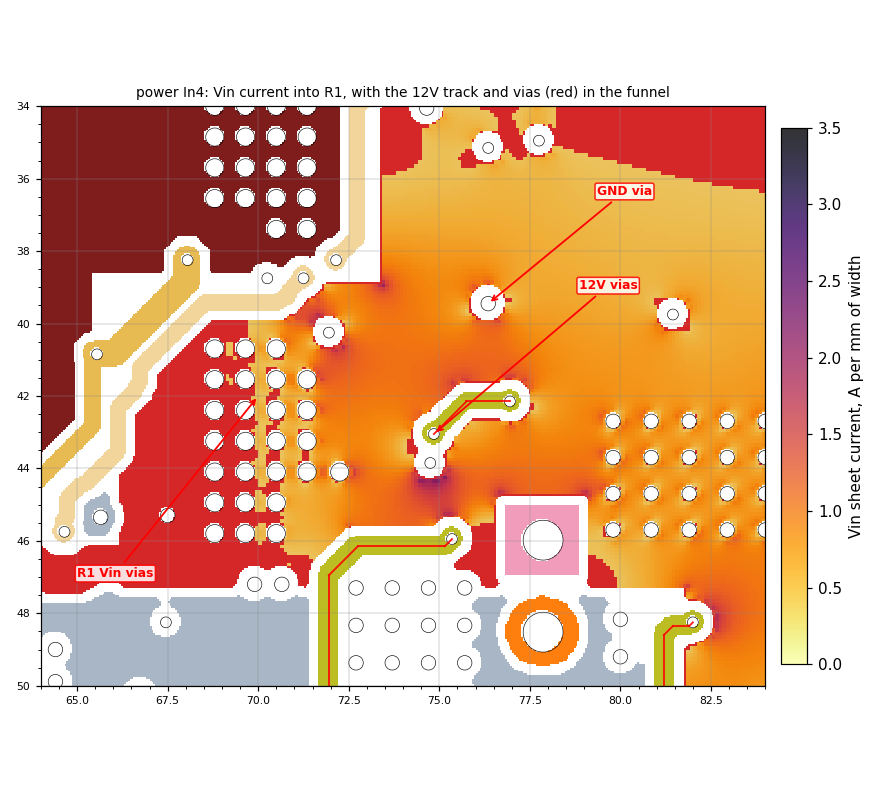

All 18.4 A from J1 converge on R1.1's via column (x 68.5-71.5, y 40-46) through a region about 5 mm wide on each layer.
Four things sit in that funnel:
- the 12V track on In4 (from (73.4, 43.1) to (76.9, 42.1), and along y = 46);
- four 12V vias: (76.95, 42.15), (74.85, 43.05), (74.75, 43.85), (75.35, 45.95);
- a GND via at (76.35, 39.45);
- the 5V/analog_5V tracks pushing in from the upper left on In4.

Each via cuts an antipad in every Vin layer.

What these vias serve (checked after the review was first written):
- **(74.85, 43.05) and (74.75, 43.85)** feed U19.16 (12V) and C31.1, its bypass cap. U19, M1's gate driver, sits on
  B.Cu inside the funnel. So 12V must still reach U19. The fix is to bring it in with fewer vias through the Vin
  layers (e.g. on B.Cu), not to take U19's supply away.
- **The GND via (76.35, 39.45)** is the ground of U25.2 and C31.2. It can shift slightly but must stay at those pads.
  The what-if below removed it, so keeping it gives back part of the gain.

**What-if** (`pcb/solve/whatif_vin_12v*`): the same copy of the export with the four 12V vias and the GND via moved
out, and the In4 12V track removed from the funnel.
- The worst neck goes from 38.8 °C to 28.9 °C.
- R goes from 1.031 to 1.000 mΩ.
- The 4 R1 vias over the IPC rating are unchanged. They are R1's own pad vias.

The 12V route from U16 to the U19 driver could go around R1 instead of through it (see also P8, the B.Cu 12V loop).

Also on this path:
- **In2 between the board notch and the M1 washer.** At x = 86-92, In2 has only 2.1-3.7 mm of Vin between the notch
  (y < 42.2) and the M1 washer keepout (`img_pcb/p03_Vin_In2_R1.png`). In3 and In4 have 8-24 mm there, so this is not
  the bottleneck.
- **rsense_lo** (`img_pcb/p05_rsense_In2.png`) peaks at 2.6 A/mm at the inside corner (65.4, 38.5), where R1's Vin
  block cuts into the rsense_lo pour. The 7 overloaded vias are the known ones next to L1/R1.

### P2. Output 1's LED path to J3 (In3), 8.5 mΩ
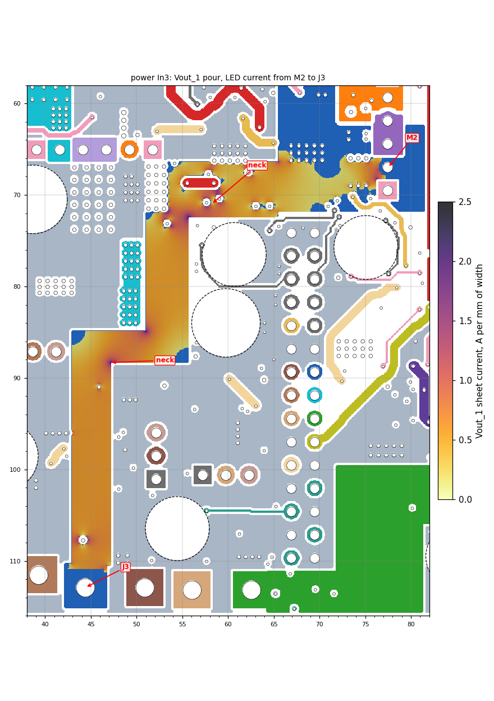

From M2.2 at (77.5, 67) the Vout_1 current has only one way to J3 (44.4, 112.9), all on In3 (30 µm):
1. left along y = 66-72;
2. down x = 51-53;
3. along y = 85-88;
4. down x = 43-47 to J3.

That is about 70 mm, 3-6 mm wide. No other layer reaches J3 with Vout_1 (on every other layer J3 is just its pad).

Pinches:
- **(55-60, 68-72):** the 1 mm D28/D29 Vin track sits inside the Vout_1 pour at y = 68.7. Below it are the H5
  standoff keepout and the GND boundary at y = 72. The neck is 2.45 mm and carries 100 % of the current.
- **The inside corners** at (51, 85) and (47, 88), 2.2 A/mm.

Effect: 22 mV and 0.06 W at 2.63 A, against 7 mV and 4 mV on outputs 2 and 3. This is not a thermal problem. It only
matters if Output 1's voltage is regulated from a point near M2 rather than at J3, or if the three outputs should match.

Options:
- move the D28/D29 Vin track out of this pour (P5);
- add a second Vout_1 path, e.g. on In4. In4 Vout_1 already covers (65-82, 55-90) with 243 mm² and 42 vias, but
  stops short of the left side.

### P3. LX to ch3 (L1 -> M5), 1.97 mΩ (In2)
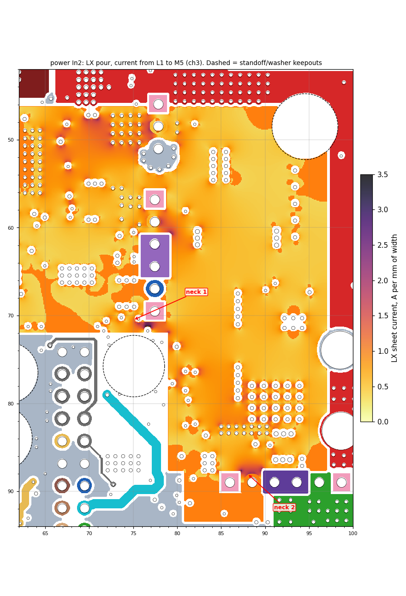
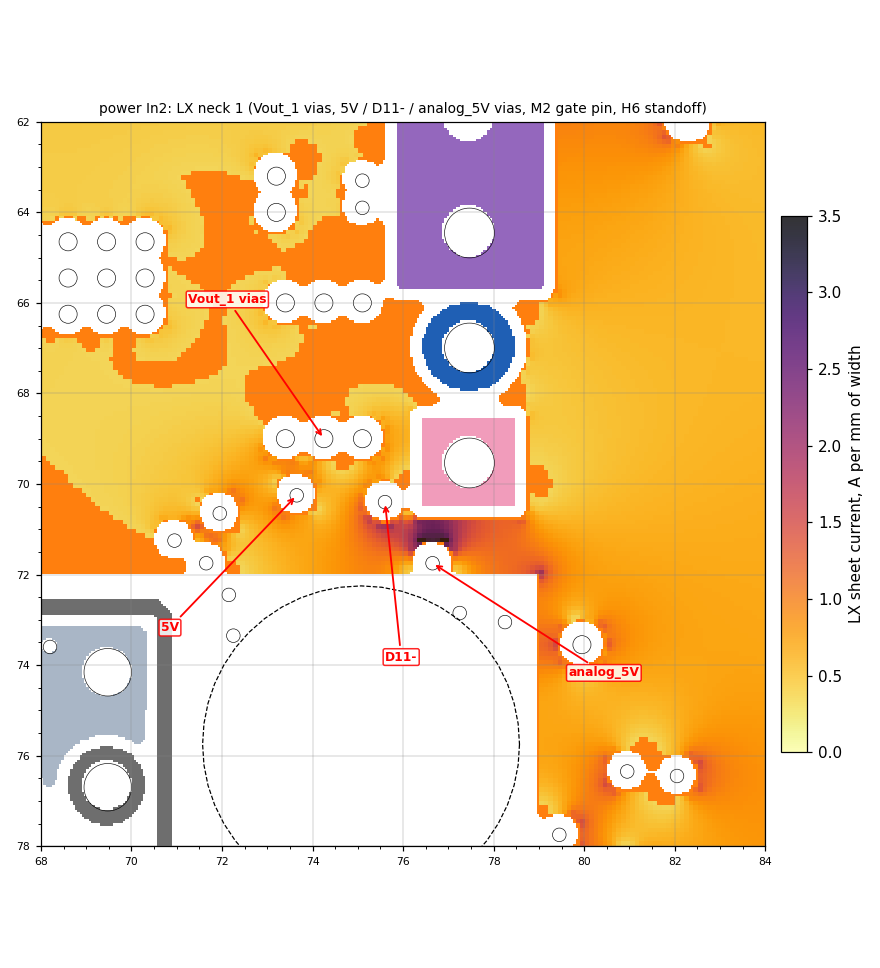

ch3's switch pair (M5/M4) is about 45 mm from L1. The current runs almost entirely on In2, plus a 187 mm² B.Cu LX piece
near M5. There are two pinches:
- **Neck 1, (71-79, 67-72), 3.4 A/mm.** The current squeezes between the H6 standoff keepout and the M2 pins. The
  M2 gate pin, a row of three Vout_1 vias (73.4-75.1, 69.0) and three small signal vias sit right in the gap:
  5V (73.65, 70.25), D11- (75.6, 70.4) and analog_5V (76.65, 71.75).
- **Neck 2, at M5's LX pin (88.5, 89.0), 3.1 A/mm.** The current converges between M5's gate pin and the m4_source
  pad. The ch3 loop GND via (88.9, 84.6) and a GATE_M4 via (90.55, 84.75) sit in the funnel.

**What-if** (`pcb/solve/whatif_lx_vias*`): moving the 5V, D11-, analog_5V and GATE_M4 vias out only takes R from
1.969 to 1.912 mΩ (-3 %). The resistance is mostly the length of 30 µm copper. Only a second LX layer along the
L1 -> M5 route would change it much, and In3/In4 are Vin there. At 0.14 W, this is a "know about it" item.

Two of those vias matter for other reasons:
- **The D11- via (75.6, 70.4)** is on M2's gate drive (R13). M2's gate loop is already 42 % unreturned, so moving it
  for a 3 % gain is not worth the risk.
- **The GATE_M4 via (90.55, 84.75)** sits right next to C76.2's GND via (88.9, 84.6), the ch3 loop via that runs
  2.7x over its rating. Moving GATE_M4's via, while keeping GATE_M4 next to m4_source, frees room for a second C76
  GND via.

### P4. Other necks found (low current, low effect)
| Where | Layer | Net (current) | What pinches it | Picture |
|---|---|---|---|---|
| (72.2, 51.5) and (74.1, 48.7) | F.Cu | LX to M1 | M1's TO-220 pin order (G-D-S): the LX block reaches M1.2 through a stem next to M1's source GND. 3.8 A/mm on F.Cu, but In2 carries most of it | `p06_LX_F_M1.png` |
| (42.7, 68.6), (46.7, 67.7) | F.Cu | Vout_2 from M3 (7.7 A) | The M9 washer keepout on one side and the M3/M6 pins on the other; a 5x6 via array fills the gap | `p10_Vout2_F_M3.png` |
| y = 96 across the strip | B.Cu | Output2_drain (2.4 A) | A row of 4 GND vias (40.1-42.3, 96.05) right across the drain strip, next to the M10 washer. **These are R53.2's pad vias**: they carry R53's 2.37 A LED return to the planes, so they must stay. Only the 3 analog_5V vias (40.65-42.35, 97.75-99.35), U12.5's supply, could move | `p07_Out2drain_B.png` |
| J4 entry (48-49, 109.4-110.2) | B.Cu | Output1_drain (2.6 A) | A block of 4 GND vias exactly where the drain strip joins J4. They serve no pad: they are stitching vias **added in the user's 2026-10-02 edit**, which raised this path from 1.75 to 1.97 mΩ, so moving them is the user's call. Also two IREF1_input vias inside the drain pour, (48.05, 102.15) and (49.65, 99.85). They are C45.1's connection: an LED-current reference passing through the sink FET's drain copper | `p09_Out1drain_B.png` |
| x = 58.5-60.2, y = 101-111 | F.Cu | Output3_drain (2.4 A) | One 1.6 mm x 10 mm strip between the H7 standoff and R7; no other layer helps | `p08_Out3drain_F.png` |

All of these are ≤ 7 mV and ≤ 0.02 W. They are worth tidying only if those areas are edited anyway, and only for vias
that do not serve a nearby pad: the analog_5V vias, and IREF1_input if C45 moves. R53's vias stay; the J4 stitching
vias are the user's call.

### P5. The D28/D29 Vin feed cuts through three layers
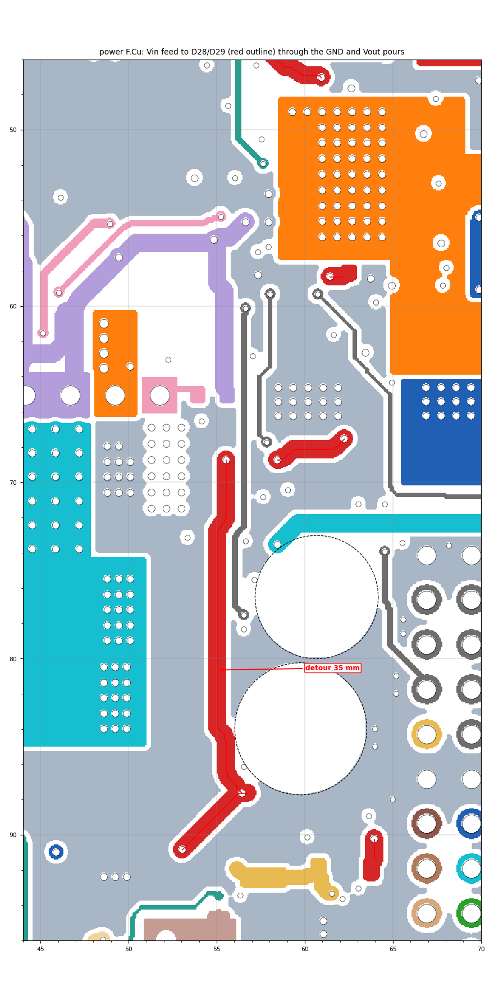
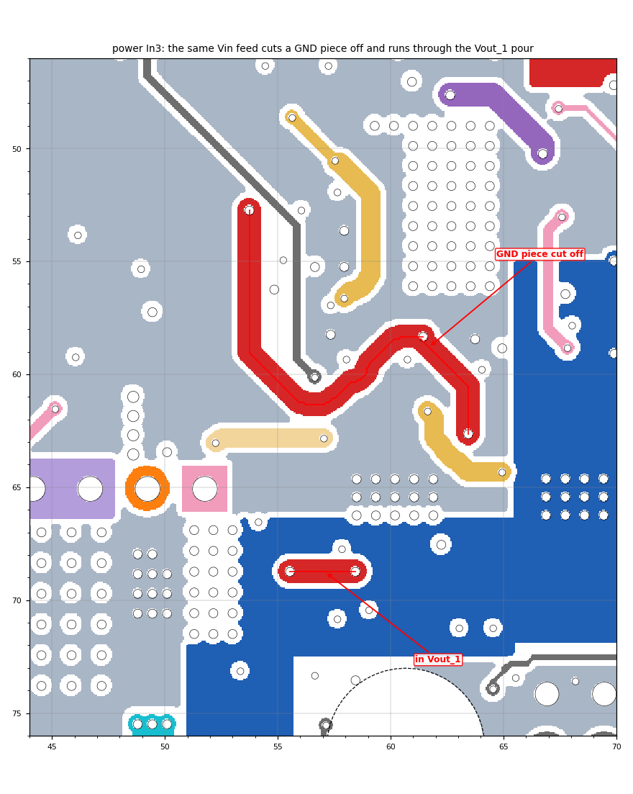

The pre-charge diodes D28 (44.6-47.4, 91.5) and D29 (50.6-53.4, 87.2) sit at the lower left, far from Vin. Their 1 mm
Vin feed crosses the board:

| Layer | What the feed does |
|---|---|
| F.Cu | The x = 55.3 track (y 69-87) splits the GND fill. Current on one side must go 35 mm around. |
| In3 | 16.4 mm of track for 9.5 mm of distance (53.75, 52.75) -> (61.45, 58.35). It cuts a 37 mm² GND piece off. A 7 mm bar at y = 68.7 sits inside the Vout_1 pour, causing the P2 pinch. |
| B.Cu | The track at (54-60, 87-89) cuts a 14 mm² GND piece off. |

These diodes only conduct during pre-charge. The feed could be routed along the board edge or kept to one layer, so
it does not slice GND three times. The 1.0 mm minimum width for Vin stays.

### P6. Switching nodes and gate tracks inside power pours
- **In4, m4_source through Vout_3** (`img_pcb/p20_In4_Vout3_m4src.png`). The m4_source track (the ch3 switch-pair
  common source, a switching node) runs diagonally through the Vout_3 pour from (80, 84) to (98, 100). That is a
  9.8 mm slot with an 11 mm detour, and it puts the switching edge right inside the quiet output pour.
- **B.Cu, D13- splits Vout_3** at (95.2, 100.8), into 78 mm² and 25 mm² pieces.
- **In4, GATE_M7 splits an LX piece** at (75.4, 58.9), into 17 mm² and 6 mm² pieces (next to M7).
- **In3, GATE_M4 and m4_source** (`img_pcb/p19_In3_GATE_M4.png`). They cut a 16 mm² GND piece (6 vias) off from the
  GND under the ch3 caps. The ch3 loop via (88.9, 84.6), one of the known 2.7x vias, sits on a narrow tongue of the
  main GND piece next to these tracks. Moving GATE_M4 would join that piece and give room for the extra loop vias the
  10-02 review asked for.

### P7. M1's source GND is an island on three inner layers
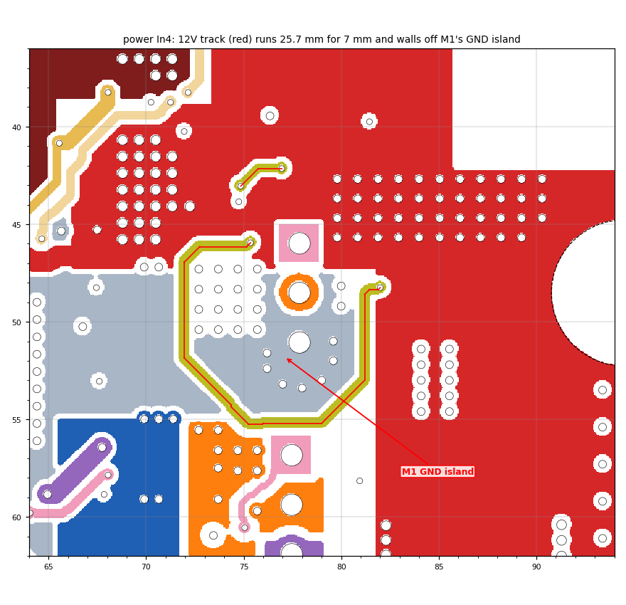

| Layer | M1's GND piece | Why it is separate |
|---|---|---|
| In2 | 9 mm² patch (8 vias) | The LX plane surrounds it |
| In3 | 52 mm² (8 vias) | The Net-(D10-) track (8.6 mm at (71.6, 51.2)) cuts it off |
| In4 | 31 mm² (8 vias) | The 12V track walls it off. That track runs 25.7 mm to cover 7 mm, from (75.35, 45.95) round the bottom of M1 to (82.0, 48.25) |

M1's 15.8 A source return therefore leaves through In1, F and B. The solve shows that is enough (0.147 mΩ, 10 °C), so
this is low priority. The In4 12V route is the same 12V as P1 and P8. One cleaner 12V route would fix all three.

### P8. GND fragmentation per layer, and the tracks that cause it
In1 (the main GND plane) is **one piece**: good. The other layers:

| Layer | GND pieces | Main pieces (mm²) | Longest tracks slicing GND (length, detour or split) |
|---|---|---|---|
| F.Cu | 15 | 2059, 690, 107 | m2_source 7.6 mm (82, 69), detour 12 mm; SNS_CH2 7.2 mm (44, 94); D28/D29 Vin 5.4 mm, detour 35 mm; Current 3.4 + 2.8 mm (top edge) |
| In2 | 4 | 2317 + small | analog_5V 6.6 mm (45.5, 98.6); 5V 6.6 mm (54, 76); the Vout_2 sense diagonal (72-80, 79-92), detour 20 mm |
| In3 | 9 | 1309, 546, 163, 52 | GATE_M4 9.2 mm (splits 16); Vin feed 8.6 mm (splits 37); D10- 8.6 mm (splits M1's 52); IREF1_input 8.6 mm, detour 13 |
| In4 | 16 | 707, 246, 163, 112, 84 | out_2_on 10.4 mm (48, 51), detour 13; M1_ON 9.4 mm (56, 58), splits 12 + 36; 12V 4.4 mm (splits M1's 31) |
| B.Cu | 17 | 1039, 587, 573, 115, 114 | 12V 13.4 mm (98.7, 58.4), **detour 51 mm**, + 11.8 mm (88, 49); analog_5V 14.2 mm (72.5, 107), detour 16, + 8.8 mm (52, 93); Output2_drain 8.2 mm (splits off the 114 mm² bottom piece); Vin 6.2 mm (splits off 14 mm²) |

Pictures: `img_pcb/p11_FCu_GND_pieces.png`, `p12_In3_GND_pieces.png`, `p13_In4_GND_pieces.png`,
`p14_BCu_GND_pieces.png`, `p15_BCu_12V_cuts_GND.png`, `p22_In4_out2on_M1ON.png`, `p23_BCu_analog5V.png`.

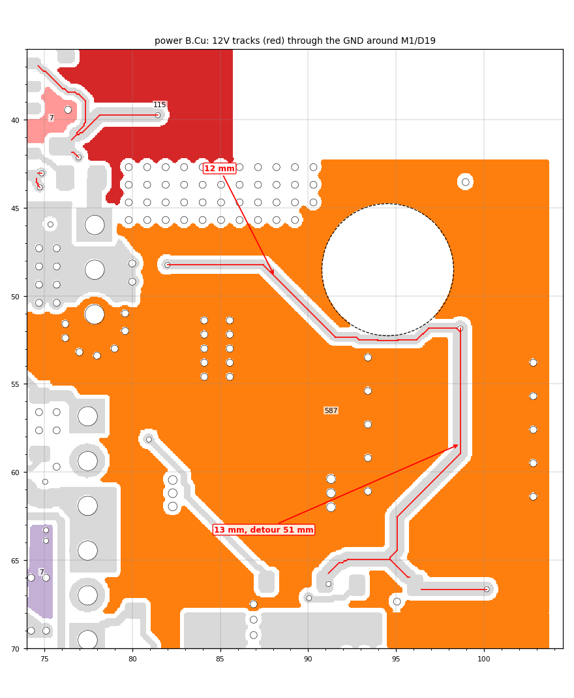

In3 and In4 are mostly Vin/Vout pours by design, so GND there is partial anyway. The worst single offenders are:
- **the 12V route** (B.Cu around the M1 washer, the In4 loop round M1, and the R1 funnel);
- **the analog_5V track** along the bottom of B.Cu.

Routing those two more directly would remove the longest slots on B.Cu and In4.

Signal tracks over power pours instead of GND (`pcb/checks/power_checks.txt`, last section):
- B.Cu analog_5V runs 14.6 mm over Vout_3 and 12.3 mm over Vout_2 on In4.
- B.Cu Net-(D13-) runs 11.2 mm over m4_source/Vout_3, a switching node.
- B.Cu 12V runs over In4 Vin in several places.

These pours are AC-quiet except m4_source.

### P9. Routing cleanliness (power)
| Net / layer | Path | Comment |
|---|---|---|
| Current, F.Cu | 46.3 mm for 27.0 mm (x1.7), (57.65, 51.95) -> (78.65, 34.95) | U25's output runs the long way across the top, past L1/R1. It slices F.Cu GND twice. `img_pcb/p21_FCu_Current.png` |
| 12V, In4 | 25.7 mm for 7.0 mm (x3.6) | The loop round M1 (P7) |
| Vout_2, In2 | 21.4 mm for 12.7 mm (x1.7), (72.05, 79.05) -> (70.15, 91.65) | The sense/feed diagonal through In2 GND, detour 20 mm |
| Net-(D8-), B.Cu | 19.3 mm for 9.7 mm (x2.0) | |
| Vin, In3 | 16.4 mm for 9.5 mm (x1.7) | The D28/D29 feed (P5) |
| ena_out_2, In2 | 14.1 mm for 8.6 mm (x1.6) | |
| GATE_M3, B.Cu | 10.3 mm for 5.4 mm (x1.9) | |
| 5V, analog_5V, B.Cu | 6.2 / 5.5 mm for 2.5 / 2.2 mm | Short wiggles |

Also:
- **674 segments under 0.15 mm** in 100 net/layer groups. These are router staircase leftovers; most are on 5V and
  12V (B.Cu, F.Cu), analog_5V and m4_source (In4).
- **Three 45° acute corners** on B.Cu: Net-(D8-) (49.87, 62.34), Net-(D13-) (89.42, 95.03), Net-(D2-) (72.27, 58.51).

---

## Control card

The card is low-current, so resistance is not the issue. The issue is **return paths**:
- F.Cu signals use In1 as their plane (0.10 mm below);
- B.Cu signals use In4 (0.10 mm above);
- In2 signals use In3 (0.12 mm).

All four inner layers carry a lot of signal routing (In1 701 segments, In2 477, In3 601, In4 738), so none of the
three GND layers is whole.

**History (found after the review was first written):**
- **This is the result of the user's 2026-09-30 decision** to go from 8 to 6 layers (`card6_2026-09-30/README.md`).
  That deleted the 8-layer card's two solid GND planes and saved about $55 for 5 cards.
- **A solid In4 plane was tried the same day and abandoned** (`card6_2026-09-30/in4plane/README.md`):
  - the card needs all six layers for signals;
  - the 2 mm rules around U2 In+ / V_err / Current block the corridor between U101 and U2/U5;
  - opening that corridor would need parts moved, which was offered and not chosen.
- **The 8-layer card still exists:** `previous/2026-09-30/before_card_6layer/` (sha 3335e701).

### C1. In1 (F.Cu's plane): 12 pieces, the centre broken up
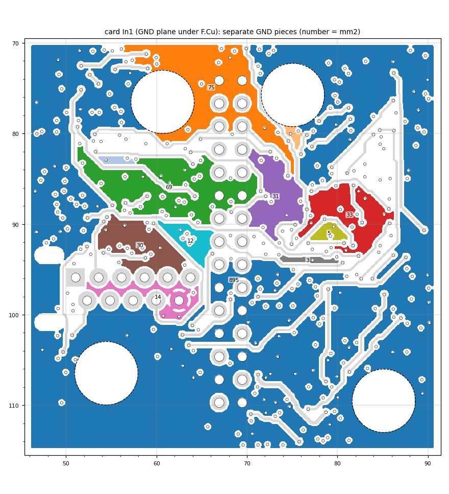

The main piece is 895 mm². Under the middle of the card (around J9, J11 and the op-amps) the plane breaks into pieces
of 75, 69, 33, 31, 30, 14, 12 and 5 mm². The 31 mm² piece at (73.2, 86.9) has only **one** via.

Tracks that alone keep pieces apart:
- 0err_hi, 13.4 mm at (59.3, 84.5);
- Net-(U101A-Y), 8.0 mm at (52.2, 85.0);
- SDA, 7.6 mm at (62.1, 100.8) and 5.8 mm at (61.8, 92.0);
- Net-(U106A-B), 7.0 mm at (62.9, 89.6);
- Net-(U24-In+), 6.6 mm at (79.5, 89.5);
- Net-(D25+) at (70.6, 73.0), which cuts off the 75 mm² top piece, and at (76.6, 88.9) and (75.5, 84.4).

Long slots with big detours:
- OUT_1_ENA, 10 mm at (79.0, 103.1), detour 49 mm;
- IREF3, 12 mm at (74.2, 101.7), detour 25 mm.

### C2. In3 (GND): 11 pieces
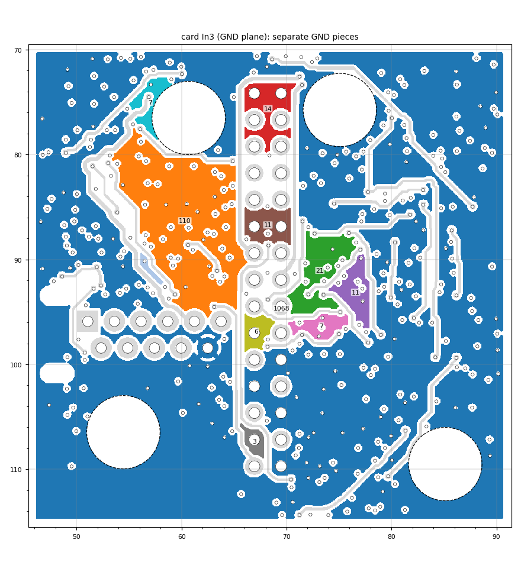

The main piece is 1068 mm². A 110 mm² piece at (60.3, 86.3), with 8 vias, is separate. Cuts:
- Output1_drain (sense), 8.8 mm at (67.4, 72.8), which splits off J11.1/J11.2's GND piece;
- OUT_1_ENA, 7.8 mm (78.2, 93.4);
- low_error_timeout, 7.2 mm (56.8, 72.7);
- IREF1, 6.6 mm (75.4, 90.8);
- 12V in two places.

### C3. In4 (B.Cu's plane): cut in two
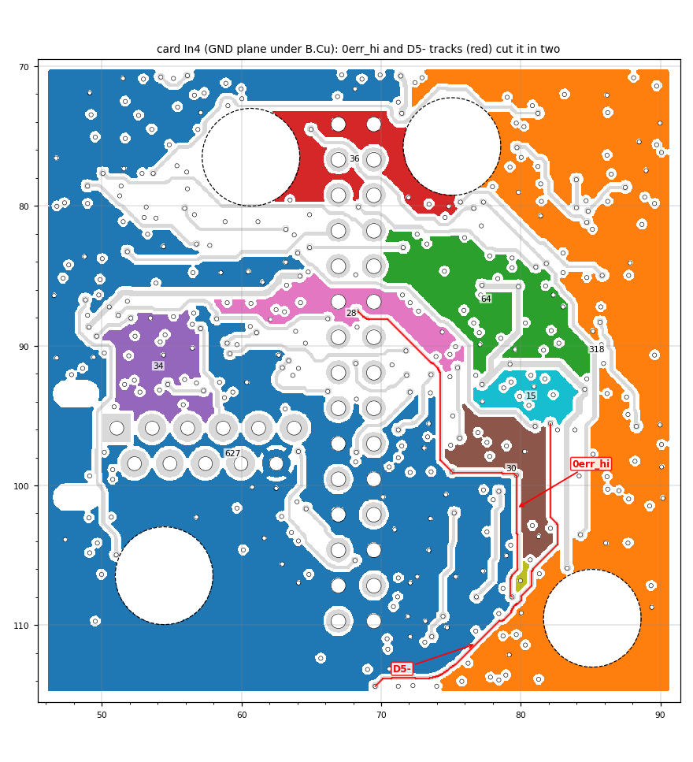

The left half (627 mm²) and the right half (318 mm²) meet only through vias. The dividing line is mainly:
- 0err_hi, 15.4 mm down x = 80-82 (y 88-107);
- Net-(D5-), 11.8 mm diagonally (70, 114) -> (82, 103);
- above them, VerrGT0 (8.6 mm, cuts off a 36 mm² piece), Net-(U103B-Y) (8.6 mm), analog_5V (7.8 and 7.0 mm) and
  Voltage_err_2 (6.8 mm).

Every B.Cu signal that crosses x ≈ 80 crosses this split. The worst gaps under B.Cu tracks are:
- 12V, 3.3 mm at (70.8, 92.1);
- set-, 3.2 mm (57.1, 75.9);
- Net-(D26+), 2.9 mm (81.8, 98.3);
- Net-(Q1-E), 2.8 mm (50.8, 90.8).

### C4. In2 (5V pour) and the outer layers
- **In2's 5V pour is one piece, with long slots** (`img_pcb/c06_In2_5V_cuts.png`):
  - Net-(U23-In+), 13.6 mm, detour 16 mm;
  - Net-(D20-), 10.2 mm;
  - ena_out_3, 9.6 mm, detour 16 mm;
  - IREF2, 5 mm, detour 46 mm;
  - Net-(U102A-Y), 4.2 mm, detour 38 mm.

  These matter for supply-plane impedance, not DC (the load is tens of mA).
- **The outer layers:** the F.Cu GND fill is in 27 pieces and the B.Cu fill in 18 (`img_pcb/c05_FCu_GND_pieces.png`,
  `img_pcb/c04_BCu_GND_pieces.png`). That is normal for component layers if the inner planes were whole.

### C5. Tracks stacked on tracks (broadside coupling)
Where two tracks run on top of each other on neighbouring layers, there is no plane between them:

| Track | Above / below | Length | Where |
|---|---|---|---|
| Reset_raw (F.Cu) | SDA (In1) | 3.7 mm | (62.3, 92.5) |
| IREF1 (F.Cu) | SDA (In1) | 3.5 mm | (65.4, 98.3) |
| VerrGT0 (In4) | Output1_drain sense (In3) | 4.7 mm | (70.4, 72.9) |
| Net-(U106A-B) (F.Cu) | Net-(D23+) (In1) | 2.4 mm | (49.7, 94.8) |
| Vref_1 (In3) | Net-(U26C-P2B) (In2) | 2.4 mm | (49.7, 94.8) |
| Net-(Q1-E) (B.Cu) | Net-(D4+) (In4) | 2.3 mm | (49.7, 94.8) |

Also over plane gaps (no copper under them):
- In4 Out-, 5.3 mm at (65.6, 83.0);
- F.Cu VerrGT0, 3.0 mm at (85.5, 76.7);
- F.Cu "4" (U18 reset), 3.2 mm at (80.4, 82.2).

### C6. Routing cleanliness (card)
| Net / layer | Path |
|---|---|
| Net-(U24-In+), In1 | 10.4 mm for 3.3 mm (x3.1). An op-amp input taking the long way, across the In1 plane |
| SDA, In1 | 18.4 mm for 9.4 mm (x2.0) |
| 0A_hi, In2 | 18.9 mm for 10.0 mm (x1.9) |
| 0err_hi, In2 | 14.8 mm for 9.8 mm (x1.5) |
| M1_INHIBIT, F.Cu | 7.2 mm for 3.2 mm (x2.3) |
| Net-(Q1-E), F.Cu | 9.2 mm for 5.6 mm (x1.6) |
| 5V, F.Cu | 5.6 mm for 2.9 mm (x1.9) |

Also:
- **2600 segments under 0.15 mm** in 239 net/layer groups. The worst are 0A_hi on In2 (74), 12V on F.Cu (67),
  0err_hi on B.Cu (53) and 12V on In3 (51).
- **Duplicate tracks out of the same via**, overlapping (0-6° corners): GND at U26.7 (58.53, 84.78), HVC/A0 at U26.4
  (56.53, 84.78), .1Vout_2 at R34/R35 (72.93, 70.83), analog_5V at U22.5 (49.08, 88.68), 5V at C96.1 (73.33, 96.53),
  GND (71.98, 79.43) and (75.48, 81.27). They are harmless but redundant.

**Options for the card** (all the user's call; see the history under "Control card" above):
1. **Go back to the 8-layer card**, which has two solid GND planes (about +$55 for 5).
2. **Move parts to open the U101-U2/U5 corridor**, then re-route with solid GND planes. This failed without moving
   parts on 2026-09-30.
3. **Targeted fixes on the 6-layer card:**
   - move the single tracks that alone split a GND piece (C1-C3);
   - stitch the one-via pieces;
   - pull the stacked track pairs (C5) apart.

A fourth idea, "In1 and In4 solid GND with signals on In2/In3", runs into the same routing limit. In2 and In3 are also
only 0.12 mm apart and 0.55 mm from the planes, so they would couple strongly to each other.

---

## Files
- `pcb/img/` - full-board pictures of every layer, both boards.
- `img_pcb/` - the zoomed pictures above (p01-p25 power, c01-c06 card).
- `pcb/checks/power_checks.txt`, `card_checks.txt` (+ `.json`) - every island, slice, neck, hot spot, routing item and
  return-path gap, with coordinates.
- `pcb/solve/now_solve.txt`, `now_vs_U6.txt` - the DC solve of the shipped power board.
- `pcb/solve/whatif_*` - the two what-if solves (P1, P3). They were run on edited copies of the export, never on a
  board.
- Tools: `pcb/pcb_checks.py`, `pcb/make_crops.py` (+ `spec_*.json`), `pcb/render_layers.py`.
